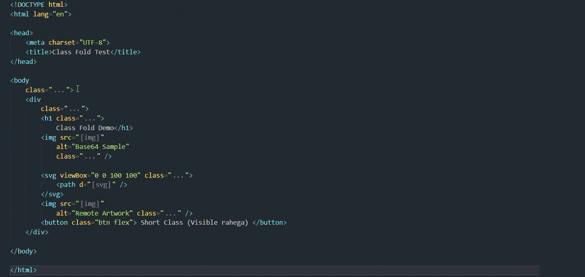

<div align="center">


# Class Fold

> **Clean, interactive inline folding for Tailwind CSS classes, JSX classNames, SVG paths, and long image URLs.**  
> Keep your markup hierarchy readable and clutter-free without disrupting your editing workflow.

[](https://marketplace.visualstudio.com/items?itemName=rahulchouhan.class-fold)
[](https://github.com/chouhan-rahul/class-fold/actions)
[](https://github.com/chouhan-rahul/class-fold/blob/main/LICENSE)

[](https://github.com/sponsors/chouhan-rahul)
[](https://buymeacoffee.com/rahulchouhan)
[](https://ko-fi.com/rahulchouhan)
[](https://paypal.me/iamchouhanrahul)

</div>

---

## Why Class Fold? 🤔

If you've ever worked on a modern project with **Tailwind CSS**, large **HTML/JSX templates**, or embedded **Base64 assets**, you already know the problem:

<p align="center">
  
</p>

```html
<!-- ❌ Before: Long class lists clutter your markup -->
<div class="flex flex-col md:flex-row items-center justify-between p-6 bg-white dark:bg-slate-900 border border-slate-200 dark:border-slate-800 rounded-2xl shadow-xl hover:shadow-2xl transition-all duration-300 ease-in-out gap-4 text-sm font-medium text-slate-700">
  <span className={'px-3 py-1.5 bg-blue-50 text-blue-600 rounded-full text-xs font-semibold uppercase tracking-wider'}>New</span>
  
</div>

<!-- ✅ After: Clean, readable component structure -->
<div class="...">
  <span className={...}>New</span>
  
</div>
```

Class Fold eliminates visual clutter so you can focus on your document's semantic structure and layout hierarchy. When you need to inspect or edit an attribute, simply move your cursor inside—it smoothly unfolds in real time.

---

## ✨ Key Features

### ⚡ High Performance & Responsiveness
- **Zero runtime dependencies**: Built natively using the VS Code Extension API.
- **Adaptive debouncing**: Instant cursor-tracking responsiveness with non-blocking document scanning.
- **Smart caching**: Document and line-level caching prevents unnecessary re-parsing of unchanged lines.

### 🎯 Universal Attribute Support
- **Tailwind & Utility Classes**: Folds `class="..."`, `class='...'`, `className="..."`, and template literals `className={`...`}`.
- **Helper Functions**: Supports `clsx(...)`, `cn(...)`, `cva(...)`, and `twMerge(...)`.
- **Framework Native**: First-class support for Vue (`:class` / `v-bind:class`), Svelte, Astro, Blade, Twig, PHP, and ERB.
- **Base64 Images & Massive URLs**: Collapses monster Base64 data URIs (`data:image/...`) and CDN links in `src="..."` or `srcset="..."`.
- **SVG Paths & Polygons**: Automatically folds lengthy `d="..."` paths and `points="..."` definitions in vector graphics.
- **Custom Regex Rules**: Add your own custom attributes or patterns in settings anytime.

### 🖼️ Live Hover Previews with Real Image Rendering
Hover over any folded badge to see an interactive preview card:
- **Classes**: View total class count, character count, and formatted token pills.
- **Images**: See an actual visual thumbnail render of Base64 or URL images right inside VS Code's hover card!
- **Quick Copy**: Click the `[📋 Copy]` link inside the hover tooltip to grab the raw content instantly.

### ⌨️ Effortless Control & Shortcuts
- **Auto-Unfolds On Cursor**: Automatically unfolds when your cursor enters the attribute value, and folds back up the moment you leave.
- **Global Toggle (`Alt + Z`)**: Turn folding on/off across your entire workspace in a split second.
- **Line Toggle (`Alt + L`)**: Quickly unfold just the current line you're working on.
- **Status Bar Counter**: Clickable status bar indicator shows the live count of folded elements (`[Fold: 14] ⚡`).

---

## ⌨️ Default Keyboard Shortcuts

| Shortcut | Action | Description |
|:---|:---|:---|
| `Alt + Z` | **Toggle Global Fold** | Turns Class Fold on or off for all files |
| `Alt + L` | **Toggle Line Fold** | Temporarily unfolds or refolds the current line |
| Context Menu | **Copy Folded Content** | Right-click any folded line to copy raw content |

> *Tip: You can customize any of these keybindings in VS Code's Keyboard Shortcuts preferences (`Ctrl+K Ctrl+S` / `Cmd+K Cmd+S`).*

---

## 🛠️ Configuration Settings

Customize Class Fold to match your preferred workflow in `settings.json`:

```jsonc
{
  // Enable or disable Class Fold
  "classFold.enabled": true,

  // Mask string displayed for folded items (e.g. "...", "⚡", "◈◈◈", "[class]")
  "classFold.maskChar": "...",

  // Use dedicated badges per content type
  "classFold.useTypeSpecificMasks": true,
  "classFold.maskCharClass": "...",
  "classFold.maskCharImage": "[img]",
  "classFold.maskCharSvg": "[svg]",

  // Badge visual style: "minimal", "pill", or "bordered"
  "classFold.badgeStyle": "minimal",

  // Trigger for temporary unfolding: "cursor", "line", "selection", or "never"
  "classFold.unfoldOn": "cursor",

  // Only fold strings longer than this threshold (keeps short classes like "flex" visible)
  "classFold.minFoldLength": 20,

  // Feature toggles
  "classFold.foldClasses": true,
  "classFold.foldImages": true,
  "classFold.foldSvgPaths": true,
  "classFold.foldCustomAttributes": true,

  // Rich hover tooltip with live thumbnail rendering
  "classFold.showHoverPreview": true,
  "classFold.hoverImagePreview": true,

  // Live counter in status bar
  "classFold.showStatusBar": true,

  // Add custom regex patterns (group 1 will be folded)
  "classFold.customPatterns": [
    "href=\"([^\"]*)\""
  ]
}
```

---

## 🌐 Supported Languages

Class Fold activates seamlessly out-of-the-box for:

- **Web & Markup**: HTML, XHTML, XML, SVG, Markdown (`.md`, `.mdx`), Handlebars, Razor
- **Modern JavaScript / TypeScript**: React JSX (`.jsx`), TypeScript React (`.tsx`), Vue (`.vue`), Svelte (`.svelte`), Astro (`.astro`)
- **Backend Templates**: PHP, Laravel Blade (`.blade.php`), Twig, ERB (Ruby on Rails)

---

## 🤝 Contributing & Feedback

Have an idea for a new feature or found a bug? Contributions and feedback are welcome!

- 🐛 [Report a bug](https://github.com/chouhan-rahul/class-fold/issues)
- 💡 [Request a feature](https://github.com/chouhan-rahul/class-fold/issues)
- 💬 [Join Discussions](https://github.com/chouhan-rahul/class-fold/discussions)
- 🤝 [Contributing Guidelines](https://github.com/chouhan-rahul/class-fold/blob/main/CONTRIBUTING.md)
- 📖 [Code of Conduct](https://github.com/chouhan-rahul/class-fold/blob/main/CODE_OF_CONDUCT.md)
- 🔒 [Security Policy](https://github.com/chouhan-rahul/class-fold/blob/main/SECURITY.md)

---

## 💖 Support & Sponsoring

If **Class Fold** saves you time and improves your development workflow, consider supporting its continued development.

- [❤️ Sponsor on GitHub](https://github.com/sponsors/chouhan-rahul)
- [☕ Buy Me a Coffee](https://buymeacoffee.com/rahulchouhan)
- [🍵 Support on Ko-fi](https://ko-fi.com/rahulchouhan)
- [💙 Donate via PayPal](https://paypal.me/iamchouhanrahul)

Every bit of support is appreciated!

---

## 📄 License

>Licensed under the [BSD 3-Clause License](https://github.com/chouhan-rahul/class-fold/blob/main/LICENSE). Built with ❤️ by [Rahul Chouhan](https://github.com/chouhan-rahul).